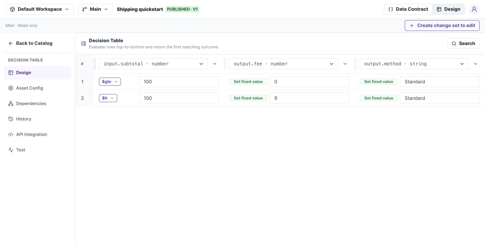

# Build a decision. Test it. Release it.

SrotaX evaluates one request document against a Decision Table, Decision Tree, or Flow and returns a result. Start with a shipping policy you can test in Studio and call from Java.

[Build your first shipping decision](quickstart.md)

*Build this two-rule shipping policy in the quickstart. Select the screenshot for a full-size view.*

## Choose your task

| I want to… | Start here |
| --- | --- |
| Define request and response fields | [Data Contracts](studio/contracts.md) |
| Reuse an object structure | [Models](studio/models.md) |
| Write ordered business rules | [Decision Tables](studio/tables.md) |
| Route through conditions | [Decision Trees](studio/trees.md) |
| Transform lists and call decisions | [Flows](studio/flows.md) |
| Share and deploy changes | [Change sets](studio/change-sets.md), then [Releases](studio/releases.md) |
| Call a released decision from Java | [Java integration](integration/java.md) |
| Check expression support | [Operator reference](reference/operators.md) |

## Understand the lifecycle

**Change set → Save draft → Test → Merge into Main → Create release → Activate environment → Execute.**

A successful draft test does not deploy a decision. A merge does not activate a release. Runtime calls use the release active in the API key's environment.

This documentation describes the locally verified implementation. See [verification and boundaries](verification.md), including what has not been certified against MongoDB.
