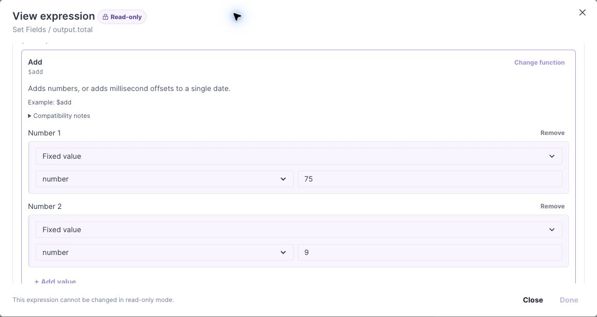

# Expressions

Visual expressions choose a supported function and supply its arguments. Advanced JSON expressions use the engine's expression syntax. The modes contain separate expressions: select the one you intend to use. They are not automatically synchronized.

## Read an expression

This example uses **Add** (`$add`) with two numeric **Fixed value** arguments: `75` and `9`. The result is `84`, assigned to `output.total` by the Set Fields step.

*The saved expression is shown in read-only mode on Main. Open an editable draft to change the function or arguments.*

To configure this example in a Flow, open **Set Fields**, select `output.total`, choose **Use expression**, and open **Edit expression**. In Visual mode, select **Add**, then provide the two number arguments. Select **Done** to update the step and **Save Draft** to save the asset. Run a test and check that `output.total` is `84`.

## Field scope and testing

`input.*`, `local.*`, `output.*`, and the current list item have different scopes. Select fields from the picker where possible. A reference that exists in another step or another asset is not automatically available at the current location.

The [operator inventory](operators.md) separates registered engine operators from functions offered to the Visual editor. Scoped operators such as `$map`, `$filter`, and `$reduce` require scope-aware configuration and are not generic Visual function entries.

Condition pickers also contain business-facing recipes built from one or more operators. A recipe name does not necessarily identify a MongoDB operator. Use [condition reference](conditions.md) to inspect their metadata.

For each expression, test its normal value, null/missing inputs, wrong types, and boundary values relevant to your contract. Structural validation cannot establish that the formula is your intended business rule.
