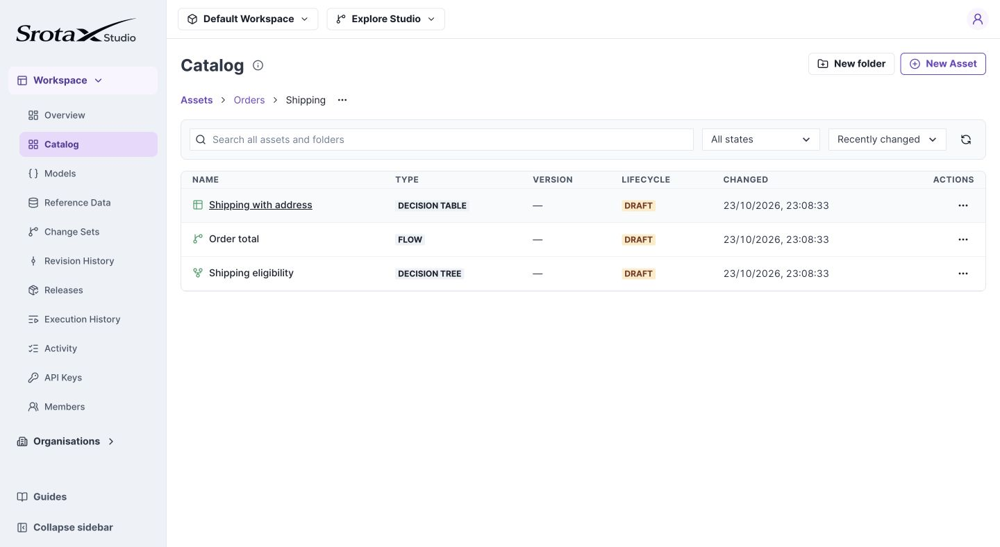
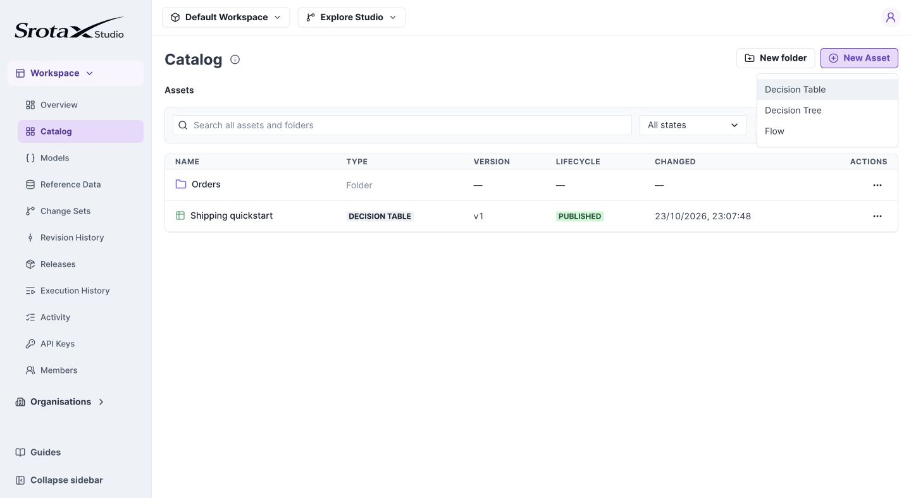

# Organize assets in folders

Create `Orders / Shipping`, then keep shipping rules together without changing their IDs.

**Before you begin:** select an editable change set. Folder edits remain there until merge.

## 1. Create a location

1. Open **Catalog** from the workspace sidebar.
2. At **Assets**, select **New folder**, enter `Orders`, and create it.
3. Open Orders, then create a folder named `Shipping`.
4. Open Shipping. The breadcrumb should read **Assets / Orders / Shipping**.

*Breadcrumbs show your current location. Select a parent to move back up. Select the image to open it at full size.*

## 2. Create or move an asset

Use **New Asset** while inside Shipping to create an asset there. Choose its type, then enter its name. To relocate an existing asset, open its **…** menu and choose **Move**.

*Choose the decision type before entering the asset details. Select the image to open it at full size.*

## 3. Find it again

Use the Catalog search to find assets and folders across the workspace. Inspect the result's location, then open it. Clear the search to resume folder browsing.

**Check your work:** the asset appears in Shipping and still opens normally. Moving it does not change references to its ID.

## If Delete folder is unavailable

The folder must be empty. Assets in other change sets can still prevent deletion even when the current view appears empty.

## Folder behavior

Nested folders are supported; Assets is the root. Organize by purpose, for example Orders / Shipping and Orders / Fulfillment.

A change set stores touched folder overrides. Untouched folders follow later changes merged into Main; your unmerged folder edits remain private to your set. A folder-only merge changes organization without creating new executable asset versions.
