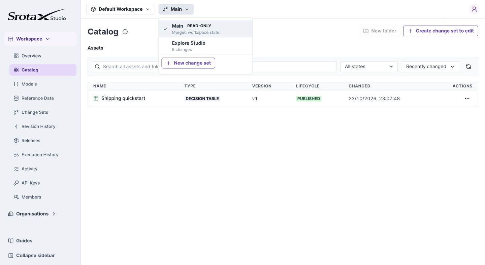

# Save and merge a change set

Use a change set to prepare edits before making them visible on Main. Saving and merging are separate actions.

**Before you begin:** you need edit and merge permissions in the workspace.

## 1. Select an editable change set

Open the change-set selector in the workspace header. Choose **New change set** to create one, or select an existing editable set. Confirm its name replaces Main in the header.

*Main is read-only. The selected change set determines where your drafts are saved. Select the image to open it at full size.*

## 2. Save and test the intended edits

Edit an asset, choose **Save Draft**, and run its tests. Repeat for every asset you intend to merge. For Models, save the model draft and retest its consumers.

**Check your work:** no intended changes remain only in an unsaved editor. A test can include unsaved work; merge cannot rely on that unsaved state.

## 3. Review and merge

Open **Change Sets**, open your set, and inspect the comparison against Main. Review added, modified, and removed resources, including contract and rule changes. Resolve any content conflicts and validation issues, then merge.

**Expected result:** the changes become available on Main. Runtime traffic remains on its active release until you [create and activate a release](releases.md).

## If merge is blocked

Read the affected asset or model in the validation result. A changed shared field may invalidate a consumer even when you did not edit that consumer directly. Fix and save those drafts, then retry the review.

## Isolation and lifecycle

A change set does not copy every asset and folder. It stores overrides for touched resources. Untouched folders follow later Main merges; it is not a fully frozen workspace copy.

Folder edits undergo structural validation without content-conflict resolution. Asset and model content conflicts still require resolution.

| Action | Effect |
| --- | --- |
| Save Draft | Persists editable work in the change set |
| Merge | Integrates changes into Main and creates immutable resource versions |
| Create release | Captures the complete Main revision |
| Activate | Selects the release an environment runs |

A published asset version does not necessarily mean that version is running in Production.
