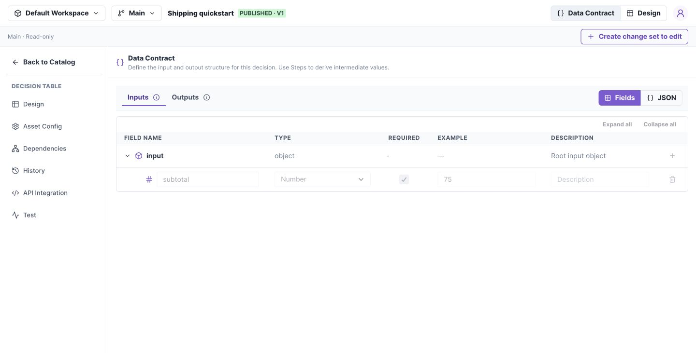
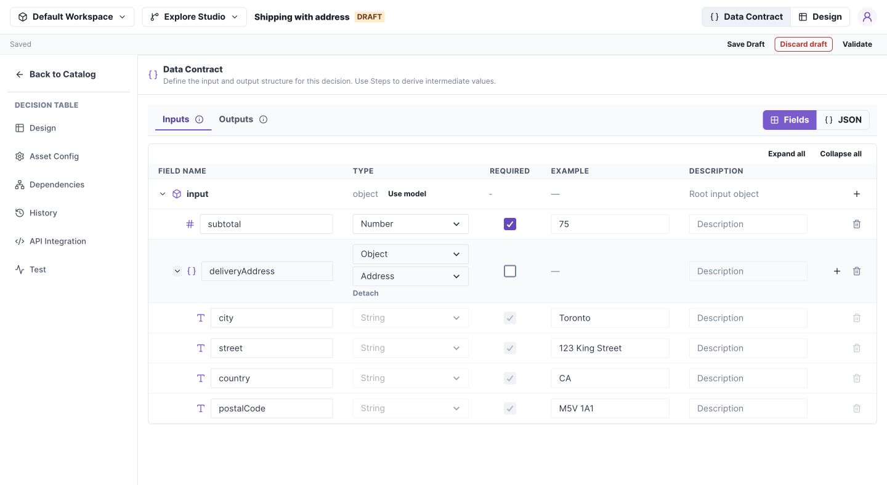

# Define a Data Contract

In this task, declare a shipping request with a numeric subtotal and a response with a fee and method. You will use these fields in the decision editor and in tests.

**Before you begin:** open a Decision Table in an editable change set. If the editor is read-only, [select a change set](change-sets.md).

## 1. Add the request field

1. Select **Data Contract**, then **Inputs → Fields**.
2. Expand the `input` row and select its **+** button.
3. Enter `subtotal`, choose **Number**, and check **Required**.
4. Set **Example** to `75`.

*The root row contains the add-field action; each child row defines one field. Select the image to open it at full size.*

## 2. Add response fields

Select **Outputs** and add `fee` as a required Number with example `9`, and `method` as a required String with example `Standard`. Choose **Save Draft**.

**Check your work:** the Design field selectors should offer `input.subtotal`, `output.fee`, and `output.method`. The request JSON is `{"subtotal":75}`; do not wrap it in an extra `input` object.

## 3. Reuse an object when needed

For an address, add an Object field named `deliveryAddress` and choose **Address** in its model selector. Create that model first using the [Models guide](models.md).

*Model children are an inspection preview. Edit their shared definition under Models. Select the image to open it at full size.*

## If a field is unavailable

Confirm that it belongs to the correct Inputs, Local, or Outputs section. If switching from JSON is blocked, fix the displayed JSON errors first. Then select Fields again.

## Contract behavior

| Section | Studio path | Purpose |
| --- | --- | --- |
| Inputs | `input.subtotal` | Request fields; immutable in Flows |
| Local (Flows) | `local.items` | Intermediate values steps may replace |
| Outputs | `output.fee` | Response fields |

An example helps construct test input. It is **not a default value** for missing production input.

Fields and JSON edit the same schema. Switching to Fields applies valid JSON automatically. Invalid JSON must be fixed before switching; there is no separate Apply action.

Selecting a model replaces custom descendants. Adding a manual child clears the binding. Detaching removes the reference and its displayed descendants; it does not keep a copied snapshot.

The authoring API calls these sections `contract.inputs`, `contract.variables`, and `contract.outputs`. Each is a nested schema object. See [schema format](../reference/schemas.md).
