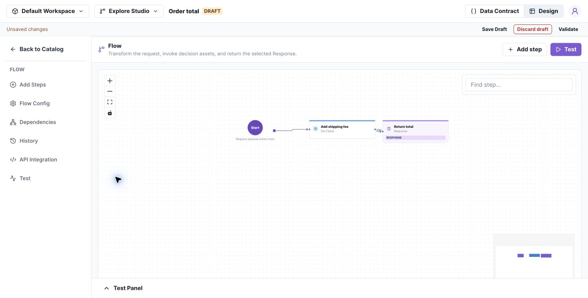

# Build a Flow that calculates a total

Start with one calculation: add a shipping fee of 9 to the request subtotal, then return the total. For a subtotal of 75, the result is 84.

**Before you begin:** create a Flow named `Order total` in an editable change set. In Data Contract, declare input `subtotal` as Number and output `total` as Number.

## 1. Add and connect steps

1. Open **Design → Add Steps**.
2. Add a **Set Fields** step and name it `Add shipping fee`.
3. Add a **Response** step named `Return total`.
4. Connect Start → Add shipping fee → Return total.

[](../images/flow-order-total.png)

*Begin with a short complete route before adding lists, branches, or dependencies. Select the image to open it at full size.*

## 2. Configure the calculation

Open Add shipping fee, add an assignment targeting `output.total`, and select **Use expression**. In **Edit expression**, choose Add (`$add`) with a field argument `input.subtotal` and a numeric fixed-value argument `9`. Complete the expression and close the step drawer.

The summary should read `output.total = (input.subtotal + 9)`. In Response, return the declared output fields.

## 3. Test the complete route

Open **Test → Test Input** and run:

```json
{"subtotal":75}
```

In Result, expect:

```json
{"total":84}
```

Use Trace to inspect the steps executed. Save Draft and Validate.

**If a field selector is empty:** confirm the field exists in Data Contract, the preceding connections are complete, and the chosen target is Local or Output. Inputs cannot be assignment targets.

Next, explore the [step reference](../reference/steps.md) when adding a list operation or a call to another decision.

## Flow behavior

### Preserve the request

`input.*` is immutable. Use `local.*` for working values and `output.*` for response fields. You do not need a separate originalInput copy.

For a list, transform `input.items` into `local.items`, filter or sort that local list, aggregate it, then assign the final output. Reuse `local.items` when its previous value is no longer needed. In-place operations must target a compatible Local list.

### Add expressions and dependencies

Visual and JSON expression modes keep separate expressions; only the selected mode is used. Changing modes does not convert the expression.

When calling a Table, Tree, or Flow, map the called asset's inputs from available fields and map its result into the caller. Review dependency selection before merge: a published dependency and a same-change-set draft are different choices.

### Complete each branch

Give every branch a complete route to a Response. Current graph editing permits one incoming connection per step; branches do not merge into a shared downstream step. Test both sides of each condition.

## Next: connect several assets

Follow [Order fulfillment with subflows](order-fulfillment.md) to combine list transformations, a reusable charges Flow, a Decision Table, a Decision Tree, and reference data in one complete example.
