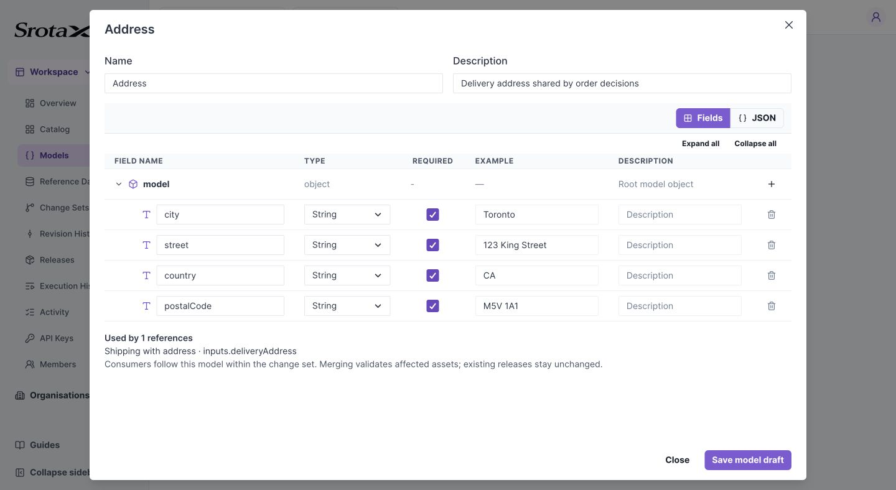
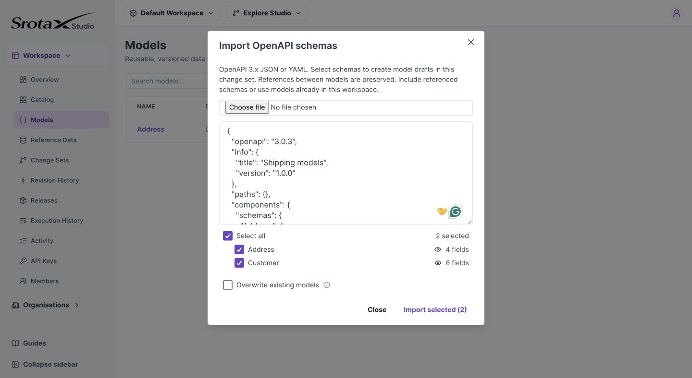

# Create and reuse a Model

Create an Address once and reference it from multiple contracts. This walkthrough also shows how to import related OpenAPI schemas.

**Before you begin:** select an editable change set. Models are shared within a workspace.

## 1. Create Address

1. Open **Models** in the workspace sidebar and select **New model**.
2. Enter `Address` as the name.
3. Expand the `model` root and use **+** to add `street`, `city`, `postalCode`, and `country`.
4. Choose String for each field, check Required, and add sample values.
5. Select **Save model draft**.

*Name, type, required status, example, and description are edited in the same field editor as Data Contract. Select the image to open it at full size.*

**Check your work:** Address appears in the Models list. It should also be available in a contract's object model selector.

## 2. Reference Address in a contract

Open an asset's **Data Contract**. Add an Object field named `deliveryAddress`, then choose Address in that row's model dropdown. Its children appear read-only. Save the asset draft.

*The contract stores a reference; it does not own a second editable copy of these fields. Select the image to open it at full size.*

## 3. Import several models together

Download the [Address and Customer OpenAPI example](../downloads/shipping-models.openapi.json).

1. Open **Models → Import OpenAPI** and supply the file or paste its JSON.
2. Check **Address** and **Customer**, or choose **Select all**.
3. Use the eye icon to inspect a model before importing.
4. If Address already exists and you intend to replace it, check **Overwrite existing models**. Otherwise deselect it and retain the existing model.
5. Select **Import selected**.

*Select related schemas together. Overwrite preserves the ID of an existing matching model. Select the image to open it at full size.*

**Check your work:** both names appear under Models, and Customer's address refers to Address. Open **Export OpenAPI** to inspect the exported component references.

## If import fails

Check the named schema in the error. Include missing referenced components, remove unsupported schema keywords, and resolve cycles. Import accepts the [supported schema subset](../reference/schemas.md), not every OpenAPI feature.

## Reference and update behavior

Models have a flat workspace namespace; there are no model packages. Object fields and object-list items can reference another model.

Consumers resolve the current model in their selected change set, falling back to Main when it has not been edited there. The editor refreshes referenced fields on focus and periodically while an editable change set is active; updates are not instant collaborative streaming.

Merging validates and recompiles affected consumers. Removing a field or changing its type can block merge until those consumers are fixed. Existing executable versions and releases retain their resolved definitions. There is no Update from model button or user-facing model version selector.

Import translates component names to stable model-ID `$ref` values; export translates IDs back to component names. A rename does not break a consumer's stored reference. Import is atomic: invalid schemas reject the operation.
