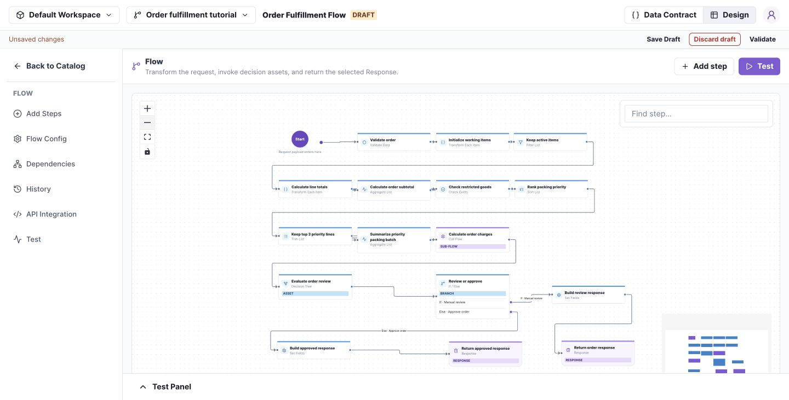
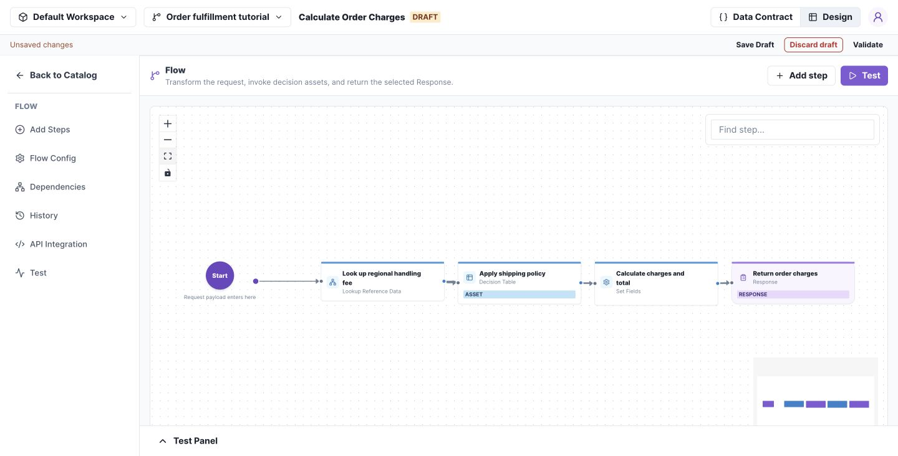
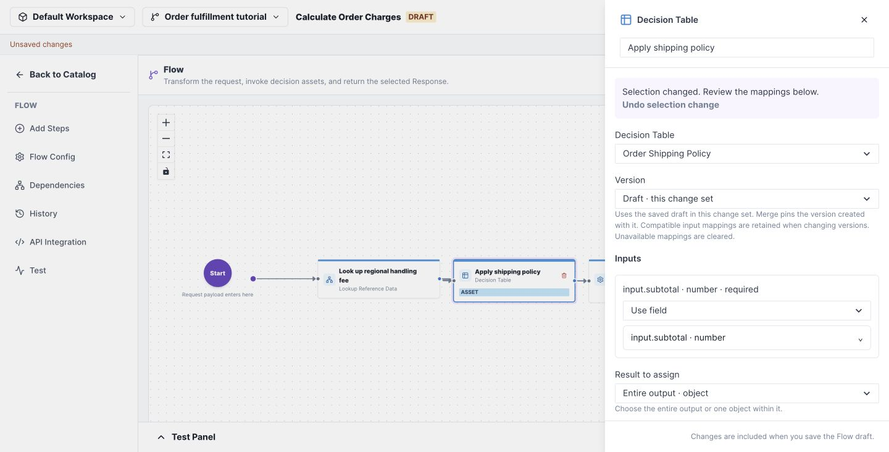
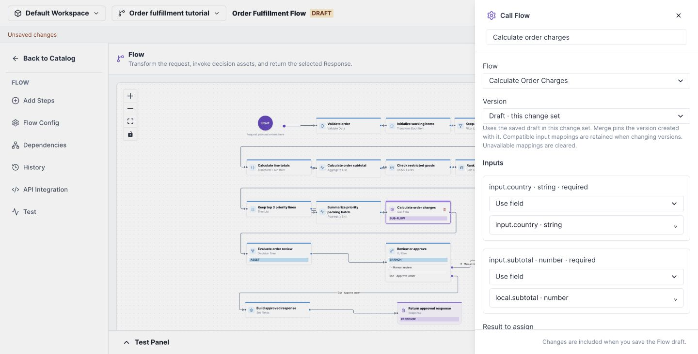
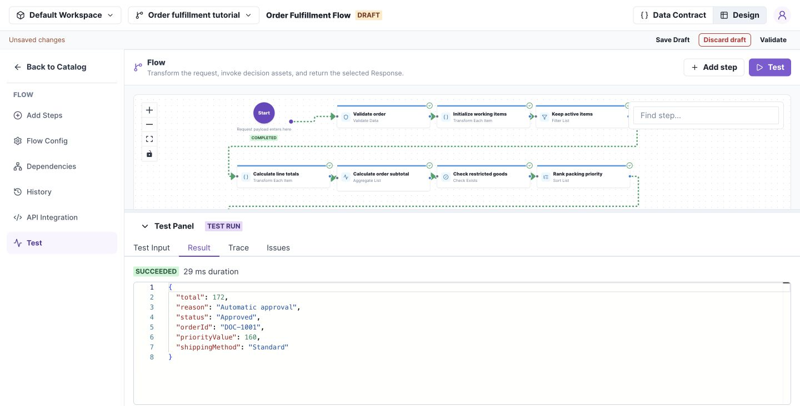
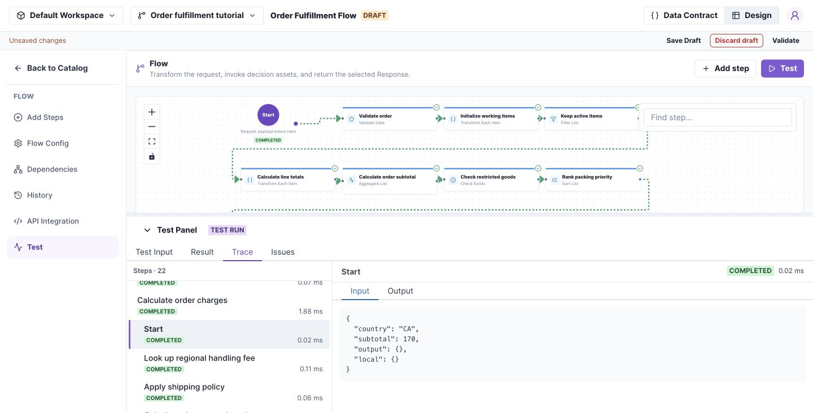

# Order fulfillment with subflows

Follow an order through a main Flow, a reusable charges subflow, a Decision Table, and a Decision Tree. This walkthrough uses the structure of **Order Fulfillment Flow** and **Calculate Order Charges** from the example workspace's Main, reproduced in an isolated workspace with synthetic data.

By the end, you should be able to explain each dependency, map its inputs and outputs, and follow a nested execution. Complete [Build your first Flow](flows.md) before starting.

## 1. Understand the connected assets

A subflow is an ordinary Flow called by another Flow through **Call Flow**. It has its own contract and execution scope; the caller supplies its inputs and chooses where to store its output.

```text
Order Fulfillment Flow
  ├─ prepare items and calculate subtotal
  ├─ Call Flow → Calculate Order Charges
  │               ├─ look up regional handling fee
  │               ├─ Decision Table → Order Shipping Policy
  │               └─ return shipping, handling, and total
  ├─ Decision Tree → Order Review Policy
  └─ return Approved or Review required
```

[](../images/fulfillment-main-flow.png)

*The purple Call Flow step invokes the reusable charges calculation. Select any screenshot to open it at full size.*

| Resource | Responsibility |
| --- | --- |
| Order Fulfillment Flow | Prepare the order, call dependencies, select the response |
| Calculate Order Charges | Combine subtotal, shipping, and regional handling |
| Order Shipping Policy | Return fee 0 when subtotal ≥ 100; otherwise 9; method Standard |
| Order Review Policy | Require review for restricted items or subtotal > 500 |
| Regional handling fees | Look up handlingFee by country; tutorial rows are CA → 2 and US → 4 |

**Before you begin:** use a dedicated workspace or change set. If your workspace already contains these example assets, open their Main versions for inspection, then create drafts before editing. Version numbers in your workspace may differ from the screenshots.

If building from scratch, create the reference data and decision assets first, then the charges Flow, then the fulfillment Flow. Define each contract before configuring its call mappings. The repository's `examples/fulfillment/assets.json` and `scripts/verify-fulfillment.mjs` reproduce the example through the API in a fresh disposable fixture; they are not a whole-workspace import button in Studio.

## 2. Define the order contract

The main Flow takes three required inputs:

| Field | Type | Meaning |
| --- | --- | --- |
| input.orderId | String | Nonempty order identifier |
| input.country | String | Regional handling lookup key |
| input.items | List of objects | Each item requires sku, quantity, unitPrice, active, restricted |

Each item has String `sku`, Number `quantity` and `unitPrice`, and Boolean `active` and `restricted`.

In **Data Contract → Local**, declare the working values: `items` (the item list plus numeric `lineTotal`), `subtotal` (Number), `hasRestricted` (Boolean), `priorityValue` (Number), `charges` (the subflow output object), and `review` (the review policy output object).

Declare outputs `orderId`, `status`, `shippingMethod`, and `reason` as String; `total` and `priorityValue` as Number. See [Data Contracts](contracts.md) for adding nested fields.

**Check your work:** field selectors offer the declared input, local, and output paths. Inputs remain unchanged during execution; all list updates below target `local.items`.

## 3. Prepare items and preserve the full subtotal

Open the main Flow's **Design** and configure these steps in execution order. Select each tile to open its drawer.

| Step | Configuration | Result |
| --- | --- | --- |
| Validate order | input.orderId is not equal to an empty string | Reject a blank ID |
| Initialize working items | Transform Each Item: input.items → a separate local.items list; copy the five item fields | Preserve the original input list |
| Keep active items | Filter List: active = true AND quantity > 0 | Retain eligible local items |
| Calculate line totals | Transform Each Item in place on local.items; lineTotal = quantity × unitPrice | Add a total to each working item |
| Calculate order subtotal | Aggregate List: sum lineTotal into local.subtotal | Total for **all** eligible items |
| Check restricted goods | Check Exists: any local item has restricted = true | Set local.hasRestricted |
| Rank packing priority | Sort local.items by lineTotal descending | Most valuable lines first |
| Keep top 3 priority lines | Trim local.items to its first 3 entries | Select the priority packing batch |
| Summarize priority packing batch | Sum remaining lineTotal into local.priorityValue | Value of that batch only |

**Why this order matters:** calculate the subtotal and restricted-item flag **before** trimming. Otherwise the shipping charge or review decision could ignore a line outside the top three. Reusing `local.items` is intentional: the earlier full subtotal is already stored separately.

## 4. Configure the charges subflow

Open **Calculate Order Charges**. Its route is Start → Look up regional handling fee → Apply shipping policy → Calculate charges and total → Return order charges.

[](../images/fulfillment-charges-flow.png)

*This Flow encapsulates pricing work so another caller can reuse it with a country and subtotal.*

Its contract is:

| Section | Fields |
| --- | --- |
| Inputs | country: String; subtotal: Number |
| Local | policy: {country: String, handlingFee: Number}; shipping: {fee: Number, method: String} |
| Outputs | shippingFee: Number; shippingMethod: String; handlingFee: Number; total: Number |

Configure **Look up regional handling fee** to read the regional dataset using key `country` and source `input.country`. Assign the row to `local.policy`. Set no-match behavior to error. In this tutorial, an unknown country must fail rather than silently charge zero.

### Call the Decision Table

1. Open **Apply shipping policy** (Decision Table).
2. Select **Order Shipping Policy**.
3. Choose a published version, or **Draft · this change set** when authoring the connected assets together.
4. Map the table's `input.subtotal` from the subflow's `input.subtotal`.
5. Select **Entire output** and assign it to `local.shipping`.

[](../images/fulfillment-table-call.png)

The table returns `{ "fee": 0, "method": "Standard" }` for 170. It does not calculate the final total.

### Build the subflow response

In **Calculate charges and total** (Set Fields), configure:

| Output target | Source or expression |
| --- | --- |
| output.shippingFee | local.shipping.fee |
| output.shippingMethod | local.shipping.method |
| output.handlingFee | local.policy.handlingFee |
| output.total | input.subtotal + local.shipping.fee + local.policy.handlingFee |

Use Add (`$add`) in the expression editor for total, then finish the route with Response. Save the subflow draft.

**Check your work:** testing the subflow with `{"country":"CA","subtotal":170}` should return shippingFee 0, shippingMethod Standard, handlingFee 2, and total 172.

## 5. Call the subflow from the main Flow

Return to **Order Fulfillment Flow** and open **Calculate order charges** (Call Flow).

1. Select **Calculate Order Charges** in the Flow dropdown.
2. Choose the published version you intend to call, or its saved draft in the same change set.
3. Configure the two input mappings below.

| Called Flow input | Source in the main Flow |
| --- | --- |
| input.country | input.country |
| input.subtotal | local.subtotal |

[](../images/fulfillment-subflow-inputs.png)

**The two input namespaces belong to different executions.** On the left, input.subtotal is the child's request field. On the right, local.subtotal is the value calculated by the parent. The child does not automatically inherit the parent's local variables.

Set **Result to assign** to **Entire output · object** and **Assign result to** to `local.charges`.

After the call, the parent reads `local.charges.total`, `local.charges.shippingMethod`, `local.charges.shippingFee`, and `local.charges.handlingFee`. The child's `local.shipping` and `local.policy` remain internal to the child.

A published-version selection remains pinned to that version. A same-change-set draft selection uses the dependency's **saved draft**, so save changes in the child before testing the parent. Review mappings whenever you change the selected dependency or contract.

## 6. Call the review decision and select a response

Open **Evaluate order review** (Decision Tree), select **Order Review Policy**, and configure:

| Called Tree input | Parent source |
| --- | --- |
| input.subtotal | local.subtotal |
| input.hasRestricted | local.hasRestricted |

Assign the entire result to `local.review`. The tree returns `requiresReview` (Boolean) and `reason` (String): restricted items require review first; otherwise a subtotal strictly above 500 requires review; the remaining orders are approved.

Configure **Review or approve** (If / Else) to test `local.review.requiresReview = true`.

Both response-building steps use these mappings:

| Output | Source |
| --- | --- |
| output.orderId | input.orderId |
| output.total | local.charges.total |
| output.shippingMethod | local.charges.shippingMethod |
| output.priorityValue | local.priorityValue |
| output.reason | local.review.reason |

Set `output.status` to **Review required** on the review branch and **Approved** on the other branch. Finish each branch with its own Response. The example does not merge both branches into a shared downstream tile.

## 7. Run the complete order and trace nested calls

Download the [sample request](../downloads/fulfillment-input.json), paste it into **Test → Test Input**, and select **Run test**.

The request includes four active lines worth 100, 40, 20, and 10, plus an inactive line worth 999. Therefore:

- Full eligible subtotal: **170**.
- Top-three priority value: **160**.
- Shipping fee: **0**.
- CA handling fee: **2**.
- Final total: **172**.

Expected Result:

```json
{
  "orderId": "DOC-1001",
  "status": "Approved",
  "total": 172,
  "shippingMethod": "Standard",
  "reason": "Automatic approval",
  "priorityValue": 160
}
```

[](../images/fulfillment-result.png)

Open **Trace**, locate **Calculate order charges**, and inspect the indented child steps underneath it. Select the child **Start** entry to see its mapped request. Check the child's mapped input first, then the regional lookup, table call, and returned output. The parent continues to Evaluate order review after the child completes.

[](../images/fulfillment-trace.png)

Try these additional inputs by replacing the items list with one active item of quantity 1, keeping country CA:

| unitPrice / restricted | Expected total | Expected status |
| --- | --- | --- |
| 20 / false | 31 (20 + 9 + 2) | Approved |
| 20 / true | 31 | Review required |
| 600 / false | 602 | Review required |

Also test an empty orderId and country ZZ; both should fail.

### Check your results

If your result differs from the expected values above, use **Trace** to find the first step with an unexpected value.

| What you see | What to check |
| --- | --- |
| Subtotal is 160 instead of 170 | Calculate the full subtotal before **Trim List**. Only the priority value should use the top three lines. |
| Charges use the priority value | In **Calculate order charges**, map the child's `subtotal` to parent `local.subtotal`, not `local.priorityValue`. |
| Country lookup fails for CA | Inspect the child's **Start** input: `country` should be `CA`. Check that the selected regional data contains a CA row. Failure for ZZ is expected. |
| Shipping fee differs from 0 for the sample | Inspect the shipping table call: its subtotal should be 170. Check the selected table's conditions and fee outputs. |
| Final total differs from 172 | Inspect the charges subflow: subtotal 170 + shipping fee 0 + handling fee 2. Then check that the parent maps `local.charges.total` to `output.total`. |

## 8. Review dependencies before release

Save all intended drafts and inspect **Dependencies** and the change-set comparison. Check the main Flow, charges subflow, shipping table, review tree, and regional data together.

The release lifecycle is **merge → create release → activate environment**. A release captures compiled asset dependencies and reference-data snapshots; merely saving the child does not update an already active runtime release. See [Releases](releases.md).

## Troubleshoot subflows

Start with the **Call Flow** step in the parent's Trace, then inspect the child steps beneath it.

| Symptom | What to do |
| --- | --- |
| Subflow receives incorrect or missing input | Inspect the child's **Start** input and compare it with the **Call Flow** input mappings. Map each required child input to the intended parent field or expression. |
| Parent cannot use a value calculated by the subflow | Return the value through the child's output contract and Response. Check the parent's result mapping and destination path; the child's `local` fields are scoped to the child. |
| Subflow returns an unexpected result | Follow the child steps in **Trace** to locate the first unexpected value. Check that step's inputs and configuration before changing the parent. |
| Changes to the subflow are not reflected | For draft testing, save the child and check whether the parent selects its draft or a published version. For deployed execution, check the environment's active release; saving a draft does not change that release. |
| A contract-changed warning appears | Reselect the intended dependency version or draft, review the input and result mappings, then validate and rerun the parent Flow. |
