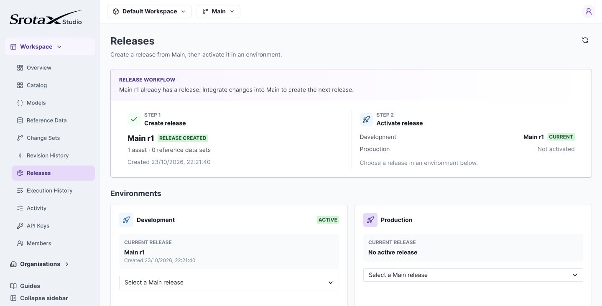

# Create and activate a release

Make a tested Main revision available to runtime callers by creating a release and activating it in an environment.

**Before you begin:** merge your intended changes, review the complete workspace, and confirm you have release and activation permissions. Use Development for this walkthrough.

## 1. Create a release from Main

1. Select **Main** in the workspace header.
2. Open **Releases** in the sidebar.
3. Create a release from the current Main revision.
4. Review the included assets and dependencies.

A release captures the whole workspace snapshot. It is not limited to the last asset you edited.

## 2. Activate Development

Activate the release for **Development**. Confirm Development points to that release and Production remains unchanged.

*Creating a release records a snapshot. Activating it selects what an environment runs. Select the image to open it at full size.*

## 3. Verify a runtime request

Use a Development API key with the [Java example](../integration/java.md) or [Runtime API](../integration/runtime.md). For the shipping policy, subtotal 75 should return fee 9 and Standard.

**If a new change is missing:** confirm it was saved, merged, included in the release, and activated in the API key's environment. A successful draft test does not change runtime behavior.

## Release behavior and rollback

A release captures exact compiled definitions and model snapshots. Creating another release for the same Main revision returns the existing release.

Development and Production each select one release. Runtime API keys are environment-scoped, so the same decision ID can produce different results in each environment.

To roll back, activate a previous release for the environment. This switches the complete snapshot, not one asset. To combine an older rule with newer unrelated rules, prepare that combination in a change set, merge it, and create a new release.

Activation does not edit Main or existing releases. Requests already executing retain the release snapshot resolved for that invocation.
