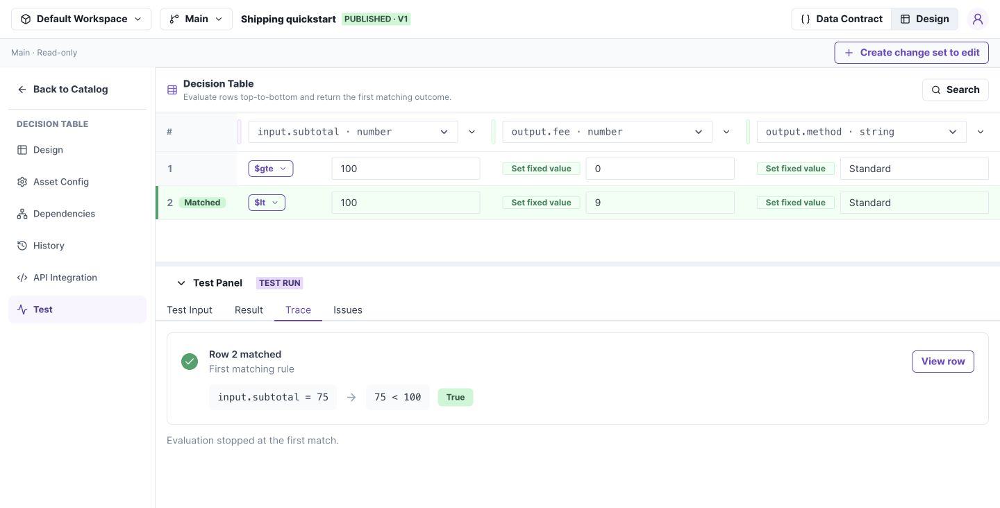

# Run a test and understand the result

Use the same Test Panel for Tables, Trees, and Flows. Start with a known input and compare the actual output with an expected value.

**Before you begin:** open an asset with a defined contract and executable rules. The [shipping quickstart](../quickstart.md) provides one.

## 1. Enter a request and run it

1. Select **Test** to open the Test Panel.
2. Open **Test Input** and enter `{"subtotal":75}` for the shipping table.
3. Select **Run test**.
4. Open **Result** and confirm fee 9 and method Standard.

## 2. Explain the result with Trace

For a Decision Table, open **Trace**. The shipping example reports **Row 2 matched**. Use **View row** to locate the rule in the table.

*Result answers what was returned; Trace identifies where that result came from. Select the image to open it at full size.*

For a Tree, inspect the executed branch. For a Flow, inspect ordered steps and nested calls. The tabs stay consistent; their contents reflect the asset type.

## 3. Test a failure deliberately

Run `{"subtotal":"wrong"}`. Open **Issues** and confirm the request fails type validation. Also test `{}` to check the required subtotal.

**Check your work:** test both shipping outcomes and the exact boundary. A successful run for 75 alone does not prove that 100 behaves correctly.

## Test scope and coverage

| Tab | Purpose |
| --- | --- |
| Test Input | Enter and execute the request |
| Result | Read the returned output |
| Trace | Inspect the matched row, tree path, or Flow steps |
| Issues | Read validation and execution failures |

On Main, the label beside Run test identifies the version. In a change set, the run uses the current draft, including unsaved changes.

Test normal cases, exact thresholds, every intended branch or row, missing required fields, incorrect types, and empty lists where relevant. Repeat affected tests after editing a shared Model.

A valid configuration can still implement the wrong business rule. Validation is structural acceptance, not proof of business correctness.
