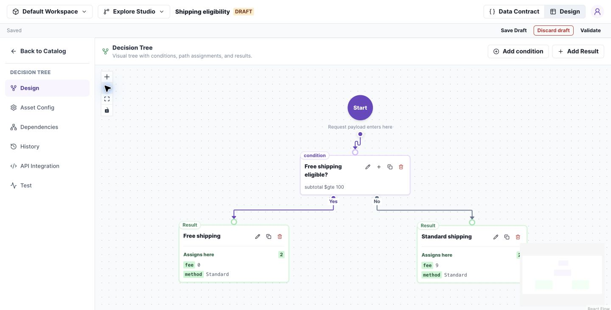
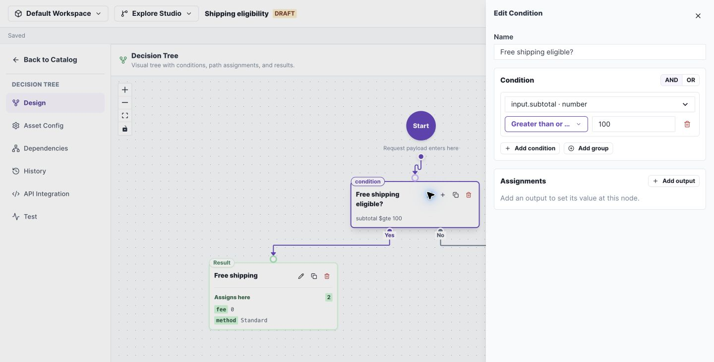

# Build a Decision Tree

Express the shipping policy as one question with two outcomes: is the subtotal at least 100?

**Before you begin:** create a Decision Tree in a change set. Define input `subtotal` as Number and outputs `fee` as Number and `method` as String.

## 1. Create the condition and outcomes

1. Open **Design** and add a condition named `Free shipping eligible?`.
2. Connect Start to the condition.
3. Add a result named `Free shipping` on the Yes branch.
4. Add a result named `Standard shipping` on the No branch.

*A complete tree routes each condition outcome to a result. Select the image to open it at full size.*

## 2. Configure the question

Open the condition's edit control. Select `input.subtotal`, **Greater than or equal to**, and enter `100`.

*The condition drawer holds the field, operator, and comparison value. Select the image to open it at full size.*

## 3. Set and test each result

Set Free shipping to `fee = 0` and `method = Standard`. Set Standard shipping to `fee = 9` and `method = Standard`.

Open **Test**, run each input, and compare Result:

| Input subtotal | Expected branch | Expected fee |
| --- | --- | --- |
| 75 | No → Standard shipping | 9 |
| 100 | Yes → Free shipping | 0 |
| 150 | Yes → Free shipping | 0 |

**Check your work:** the executed path agrees with the result. Save Draft and Validate before [merging](change-sets.md).

**If a route fails:** check that both condition outcomes are connected and each result supplies the declared outputs.

## Tree behavior

Test every reachable result leaf and exact condition boundaries. The graph indicates the executed path; tile colour alone is not execution evidence.

On Main, zoom and navigation remain available. Adding conditions or results requires an editable change set. Missing branches and invalid outputs must be fixed before merge.
